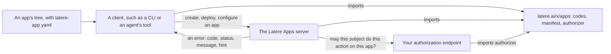

# apps

**apps is the contract between Latere Apps and its clients: the error
codes the platform answers with, the grammar of `latere-app.yaml`, and
the vocabulary of an authorization endpoint for Apps.** Latere Apps
builds an app from its repository and serves it at its own address. The
Latere Apps server imports this Go module, and a client imports it to
check a manifest offline the way the server does and to print the same
sentence for an error, without importing any of the server.

[](https://pkg.go.dev/latere.ai/x/apps)

## Status

The module is before v1.0.0. The names on the wire are stable: a code,
an action, a kind, a resource field and a limits member are never renamed
or removed, so a client built from an older release keeps working. The
Go API around them can still change in a minor release, and the section
of each release in the [changelog](CHANGELOG.md) names each incompatible
change. The [releases page](https://github.com/latere-ai/apps/releases)
lists the releases. The module has had no external security audit;
[`SECURITY.md`](SECURITY.md#what-is-protected) gives what it protects,
and the test that checks each property.

| Part | State |
|---|---|
| `codes`: every code with its status, message and hint | Works |
| `manifest.Parse`: the grammar, unknown keys with their line, and bounds on size and nesting | Works |
| `manifest.Resolve`: defaults and every rule for static sites, services, components, links, data services and references | Works |
| `manifest.Detect`: a static site or a service, told from the app's files | Works. A Dockerfile is detected and refused while Dockerfile builds are not available |
| `manifest.Schema`: the grammar as a JSON Schema | Works. The limits of `Parse` on the file, and the rules that need the app's files or the platform's limits, are not in it |
| Component kinds `worker` and `cron`, `service.dockerfile`, and replica counts other than 1 | In the grammar. `Resolve` refuses them as not available yet |
| `authorizer`: the actions, the resource of each question, and the limits an allow may grant | Works |
| A `Tree` over a directory or a repository | Not built. A client writes its own; the quickstart has one in a few lines |

## Quickstart

You need Go 1.27 or later. The program below checks a `latere-app.yaml`
with a typo, prints the refusal the platform would send, and then
resolves the corrected file against an app's files. It needs no network
beyond the module download, and no account.

```sh
mkdir apps-quickstart && cd apps-quickstart
go mod init quickstart
cat > main.go <<'GO'
// Command quickstart checks two latere-app.yaml files the way the Latere
// Apps server does, with no network and no account.
package main

import (
	"errors"
	"fmt"
	"log"

	"latere.ai/x/apps/codes"
	"latere.ai/x/apps/manifest"
)

// tree is an app's files in memory. A client reads them from disk or from
// a repository.
type tree map[string]string

func (t tree) Files() []string {
	names := make([]string, 0, len(t))
	for name := range t {
		names = append(names, name)
	}
	return names
}

func (t tree) ReadFile(name string) ([]byte, error) {
	data, ok := t[name]
	if !ok {
		return nil, fmt.Errorf("%s: no such file", name)
	}
	return []byte(data), nil
}

func main() {
	// A typo: the key is dir, not dri.
	_, err := manifest.Parse([]byte("kind: static\nstatic:\n  dri: dist\n"))
	var refused *manifest.Error
	if !errors.As(err, &refused) {
		log.Fatalf("want a refusal, got %v", err)
	}
	code, _ := codes.Lookup(refused.Code)
	fmt.Println("refused:", refused.Code, code.Status)
	fmt.Println("message:", code.Message)
	fmt.Println("hint:   ", code.Hint)
	fmt.Println("key:    ", refused.Details["key"], "on line", refused.Details["line"])

	// The same file, corrected, resolved against the app's files.
	m, err := manifest.Parse([]byte("kind: static\nstatic:\n  dir: dist\n"))
	if err != nil {
		log.Fatal(err)
	}
	files := tree{"latere-app.yaml": "", "dist/index.html": "<h1>hello</h1>"}
	r, err := manifest.Resolve(m, files, manifest.Options{Limits: manifest.DefaultLimits()})
	if err != nil {
		log.Fatal(err)
	}
	for _, c := range r.Components {
		fmt.Printf("serves:  %s component %q from %s at %s\n", c.Kind, c.Name, c.Static.Dir, c.Route)
	}
}
GO
go mod tidy
go run .
```

It prints:

```
refused: manifest_unknown_key 400
message: `latere-app.yaml` has a key the platform does not know.
hint:    Check the key against the reference at platform.latere.ai/docs/apps/manifest.
key:     static.dri on line 3
serves:  static component "app" from dist at /
```

## How it fits



- **A client** reads the app's tree, checks `latere-app.yaml` with
  `manifest` before it deploys, and prints an error the server
  sends from `codes` by its code. A client compiled from an older release
  still knows every code it was built with.
- **The server** refuses a manifest with the same code, key and line as
  the client, and answers every error from the `codes` table.
- **An authorization endpoint**, when an installation has one, answers
  the server's questions. `authorizer` gives it every action, the
  resource each question carries, and the limits an allow may grant, on
  the envelope of
  [`latere.ai/x/pkg/authz`](https://pkg.go.dev/latere.ai/x/pkg/authz).

## Packages

| Package | What it gives you |
|---|---|
| [`codes`](https://pkg.go.dev/latere.ai/x/apps/codes) | Every error code Apps answers with: the HTTP status, the one sentence a user reads, and the one hint. A client prints the same sentence offline that the API sends |
| [`manifest`](https://pkg.go.dev/latere.ai/x/apps/manifest) | The grammar of `latere-app.yaml`: `Parse` refuses a key the platform does not know with its line, `Detect` tells a static site from a service, `Resolve` applies the defaults and every rule to one tree, and `Schema` is the same grammar as a JSON Schema |
| [`authorizer`](https://pkg.go.dev/latere.ai/x/apps/authorizer) | The vocabulary an authorization endpoint for Apps is written against: every action the server asks, the resource each question carries, and the limits an allow may grant |

## Documentation

| Document | What you find there |
|---|---|
| [API reference](https://pkg.go.dev/latere.ai/x/apps) | Every exported type and function, with its documentation |
| [Manifest reference](https://platform.latere.ai/docs/apps/manifest) | Every key of `latere-app.yaml`, with its default and an example |
| [JSON Schema](https://platform.latere.ai/docs/apps/latere-app.schema.json) | The same grammar for an editor: the bytes `manifest.Schema` returns |
| [Changelog](CHANGELOG.md) | What changed in each release, and each incompatible change |
| [Security](SECURITY.md) | What the module guarantees, the test behind each guarantee, and what it does not defend |

## Contributing

[`CONTRIBUTING.md`](CONTRIBUTING.md) says how to set up, the rules a
change keeps, and how to send it. Do not report a vulnerability in an
issue: [`SECURITY.md`](SECURITY.md) says where to send it.

## License

Apache-2.0. See [LICENSE](LICENSE).
